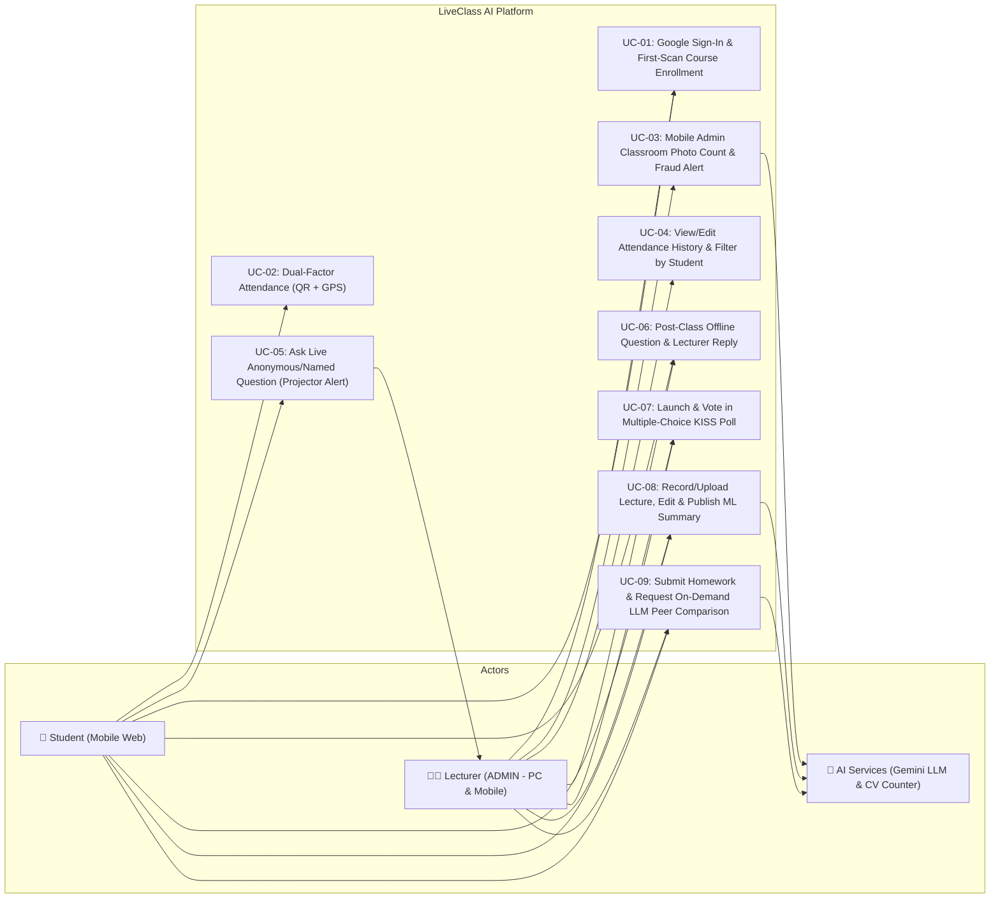

# Main Use Cases & Client Stories — Task 6

**Project:** LiveClass AI — Web-Based Teaching Tool  

---

## 1. Use Case Diagram

---

## 2. Agile Client Stories (User Stories)

| ID | Actor | User Story | Acceptance Criteria |
| :--- | :--- | :--- | :--- |
| **US-01** | Student | *As a student in the first lecture, I want to scan the lecturer's QR code once after signing in with Google so that I am both enrolled in the course and marked present.* | Course appears permanently in "My Courses" from Lecture #2 onward. |
| **US-02** | Student | *As an enrolled student in Lecture #2+, I want to mark attendance either by scanning the QR or clicking into the course on the website while in class.* | Server validates active session + Haversine GPS distance $\le 60\text{m}$. |
| **US-03** | Lecturer | *As a lecturer, I want to snap a photo of the classroom from my phone (connected as Admin) and have the AI headcount appear live on my laptop screen.* | Photo uploads to server, counts people, updates PC via Socket.IO, and alerts if `Registered > Photo Count`. |
| **US-04** | Lecturer | *As a lecturer, I want to manually edit attendance and filter the attendance history by a specific student across all lectures.* | Online table filters by student or session and exports to Excel/CSV. |
| **US-05** | Student | *As a student who is shy to interrupt, I want to send an anonymous question from my phone that pops up with a sound on the lecturer's projected screen.* | Chime plays, OS notification fires even over PowerPoint, and lecturer clicks "Dismiss" after answering verbally. |
| **US-06** | Student | *As a student studying at home after class, I want to ask a question on the same course page and receive a written reply from the lecturer.* | Lecturer sees unread badge, types reply, reply appears on course Q&A feed. |
| **US-07** | Lecturer | *As a lecturer, I want to launch a quick multiple-choice poll on the spot and show the live bar chart only on my projector screen.* | Students vote via open session link or direct poll QR; phone shows confirmation only; projector shows live chart. |
| **US-08** | Lecturer | *As a lecturer, I want to click "Start Recording" (or upload a recording), review the AI-generated summary (including live Q&A), and publish it to the course page.* | Draft summary is editable by lecturer; once published, all enrolled students see it by lecture date. |
| **US-09** | Student | *As a student, I want to upload my homework (GitHub repo or file/code) and click "Get LLM Review & Comparison" whenever I want.* | LLM analyzes submission, compares anonymously to all peers submitted so far; lecturer can also view all submissions and reviews. |

---

## 3. Detailed Use Case Specifications

### UC-02 & UC-03: Dual-Factor Attendance & Mobile Admin Photo Verification
- **Primary Actors**: Student (`STUDENT`), Lecturer (`ADMIN` on Laptop & Smartphone).
- **Preconditions**: Lecturer has signed in via Google as `ADMIN` and started a live session for Course $C$.
- **Main Success Scenario**:
  1. Lecturer's laptop captures classroom GPS coordinates $(\text{lat}_L, \text{lng}_L)$ and displays the Session QR code on the projector.
  2. Student scans QR (or selects Course $C$ from "My Courses"). If not yet enrolled in Course $C$, the system auto-enrolls the student.
  3. Student's browser captures GPS coordinates $(\text{lat}_S, \text{lng}_S)$ and sends check-in request.
  4. Server computes Haversine distance $d$. Since $d \le R_{\text{max}}$, student is marked `PRESENT (VERIFIED)` and the lecturer's live roster increments $N_{\text{digital}}$.
  5. Lecturer opens LiveClass AI on their smartphone (logged in as `ADMIN`), taps **"Snap Classroom Photo"**, and photographs the lecture hall.
  6. Server/AI detects $N_{\text{photo}}$ persons and pushes the annotated result to the lecturer's laptop via Socket.IO.
- **Extensions (Alternative Flows)**:
  - **3a. Remote Spoofing Attempt ($d > R_{\text{max}}$)**: Server rejects automatic verification or flags status as `OUT_OF_RANGE` with distance in meters.
  - **6a. Headcount Discrepancy ($N_{\text{digital}} > N_{\text{photo}}$)**: Dashboard displays a red fraud alert banner (`Warning: 24 students registered digitally, but only 19 people detected in classroom photo!`). Lecturer inspects the live table and manually unchecks absent students.

### UC-05 & UC-06: Live & Offline Q&A Flow
- **Primary Actors**: Student, Lecturer.
- **Main Success Scenario (Live Class)**:
  1. Student types a question in the session view, optionally checks **"Ask Anonymously"**, and taps Send.
  2. Server saves question with `is_live = true` and emits `question:new` via Socket.IO.
  3. Lecturer's laptop plays the Web Audio dual-tone chime, triggers an OS Desktop Notification (visible above presentation slides), and shows a high-contrast projector popup card.
  4. Lecturer answers the question verbally to the class and clicks **"Got it / Dismiss"** on the popup.
- **Alternative Flow (Offline Post-Class)**:
  1. After the live session is closed, student opens the course from "My Courses" and submits a question (`is_live = false`).
  2. Lecturer logs in later, sees an unread notification badge on the course Q&A tab, types a written answer, and clicks **"Send Reply"**.
  3. Student views the lecturer's written answer on the course page.

### UC-09: Configurable Homework & On-Demand LLM Peer Comparison
- **Primary Actors**: Lecturer, Student, Gemini LLM Engine.
- **Main Success Scenario**:
  1. Lecturer creates an assignment specifying allowed format (`GITHUB_ONLY`, `FILE_OR_TEXT`, or `BOTH`).
  2. Student submits their solution (e.g., GitHub repository URL and/or code/text).
  3. Student clicks **"Get LLM Review & Peer Comparison"**.
  4. Server retrieves the student's submission content (fetching repository README/structure if a GitHub URL is provided) plus all other submissions currently stored for that assignment.
  5. `LLMService` generates a deep architectural review and an anonymized comparison against peers who submitted up to that point.
  6. Both the student (on their submission card) and the lecturer (in the assignment submissions inspector) can view the detailed markdown feedback.
