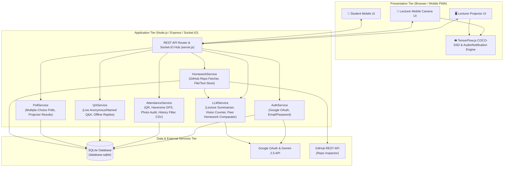
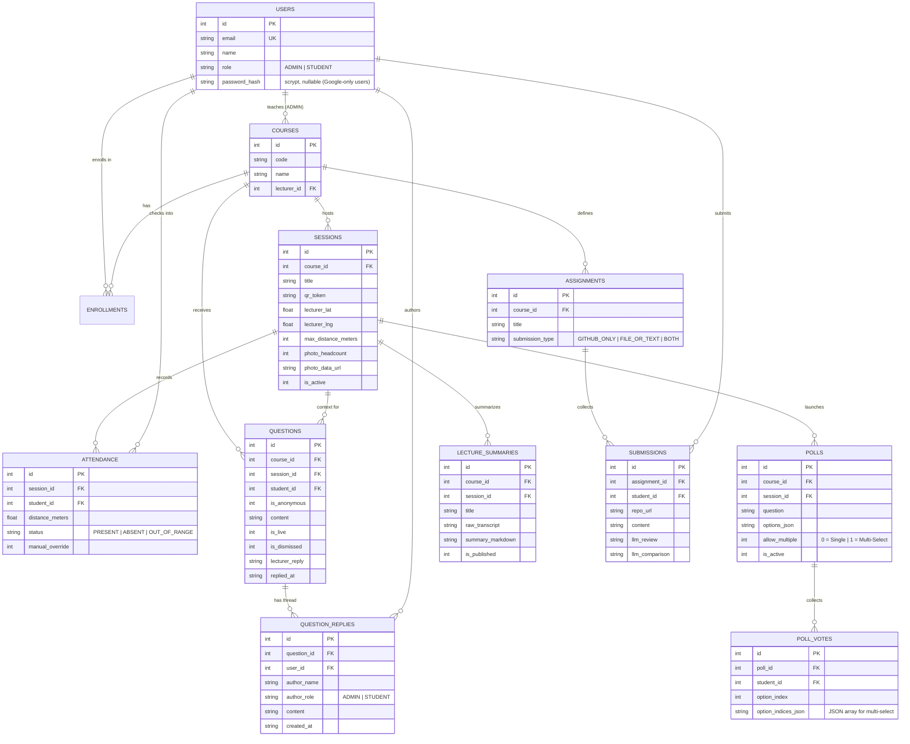

# Main Software Components & Architecture — Task 7

**Project:** LiveClass AI — Web-Based Teaching Tool  

---

## 1. Architectural Pattern

LiveClass AI employs a **Layered Service-Oriented Architecture (SOA)** combined with an **Event-Driven Real-Time WebSocket Bus (Socket.IO)**:

1. **Presentation Layer (`public/`)**:
   - Responsive Single-Page Application (SPA) serving three synchronized views:
     - **Lecturer Desktop Dashboard (`ADMIN` Projector View)**
     - **Lecturer Mobile Companion (`ADMIN` Smartphone Camera & Remote Control)**
     - **Student Mobile Web App (`STUDENT` View)**
   - Client-side AI & Media modules: TensorFlow.js (`coco-ssd`) person detector, Web Audio chime synthesizer, Web Notifications bridge, HTML5 Geolocation, and Web Speech / Audio Recorder.
2. **Controller & Real-Time Transport Layer (`src/server.js`)**:
   - Express REST API controllers + Socket.IO room-based event broadcaster (`course:<id>` and `session:<id>`).
3. **Domain Service Layer (`src/services/`)**:
   - Encapsulated OOP business logic classes: `AuthService`, `AttendanceService`, `QAService`, `PollService`, `LLMService`, `HomeworkService`, and `UserManagementService`.
4. **Data Access & Persistence Layer (`src/db/database.js`)**:
   - Relational SQLite database managed via Node.js v22 native `node:sqlite` (`DatabaseSync`).

---

## 2. Component Diagram

---

## 3. Software Component Responsibilities

| Component Class | File Location | Core Responsibilities |
| :--- | :--- | :--- |
| **`DatabaseManager`** | `src/db/database.js` | Initializes SQLite schema, executes parameterized queries, and seeds realistic courses, students (from lecturer's roster), sessions, and sample GitHub homework repositories. |
| **`AuthService`** | `src/services/AuthService.js` | Verifies Google OAuth tokens, registers/authenticates email+password users (scrypt hashes), resolves per-user `STUDENT`/`ADMIN` roles, and issues signed session tokens. |
| **`AttendanceService`** | `src/services/AttendanceService.js` | Manages multi-course enrollment on first QR scan, creates live sessions, computes Haversine GPS distance, processes mobile-to-PC classroom photo headcounts, flags over-registration alerts, supports manual attendance toggling, filters attendance history by student across all lectures, and generates CSV/Excel exports. |
| **`QAService`** | `src/services/QAService.js` | Handles live and offline student questions (with optional anonymity and projector dismissal), multi-reply threads (`question_replies`), lecturer/student replies that trigger real-time `question:replied` OS push notifications to the student who asked, multi-filter Lecturer Question History (`getQuestionHistory`), and CSV history export (`exportQuestionsCSV`). |
| **`PollService`** | `src/services/PollService.js` | Creates single-choice or multi-select (`allow_multiple`) polls with dynamic options, generates direct poll QR codes, records single or multi-option (`option_indices_json`) ballots per student, and aggregates vote counts and voter percentages exclusively for the lecturer's display. |
| **`LLMService`** | `src/services/LLMService.js` | Interfaces with Google Gemini API (plus deterministic analytical fallback) for: (1) Lecture transcript + live Q&A summarization with draft/publish workflow, (2) Server-side classroom photo headcount analysis, and (3) On-demand student homework deep review & cohort comparison. |
| **`HomeworkService`** | `src/services/HomeworkService.js` | Creates assignments with configurable submission modes (`GITHUB_ONLY`, `FILE_OR_TEXT`, `BOTH`), fetches GitHub repo metadata when a repo link is submitted, stores student submissions, and triggers `LLMService` peer comparisons. |
| **`UserManagementService`** | `src/services/UserManagementService.js` | Admin-only user directory and profile inspector: lists users with activity counts, updates user roles (`STUDENT`/`ADMIN`) with safety guards, manages course enrollments, and aggregates a user's attendance, questions, poll votes, and homework submissions. |

---

## 4. Entity-Relationship Diagram (Database Schema)

