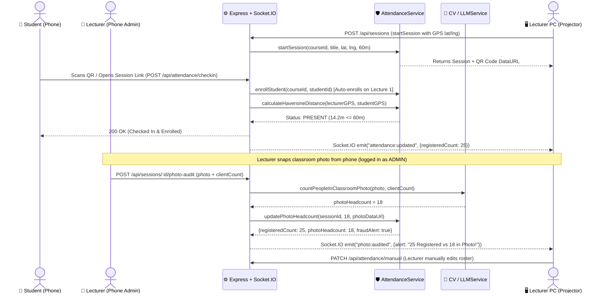
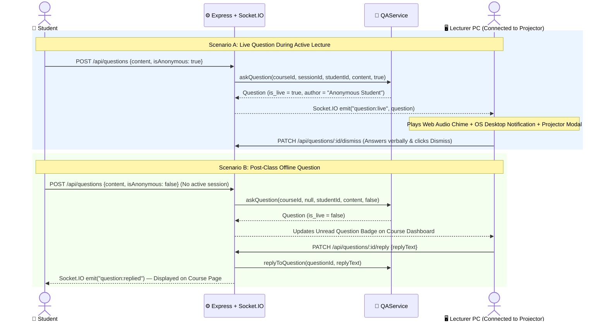
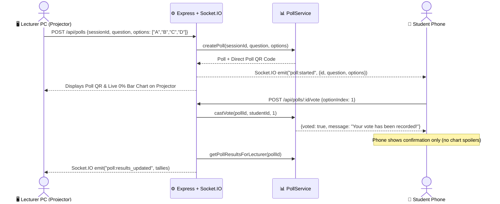
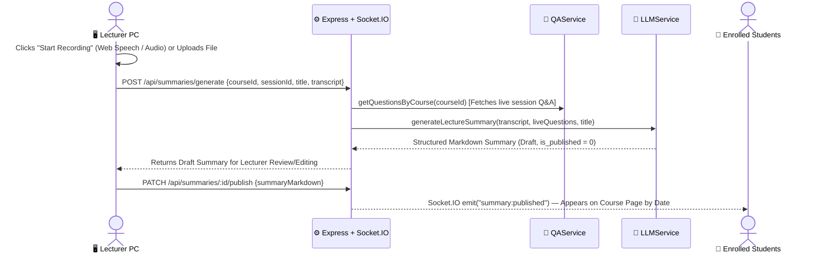
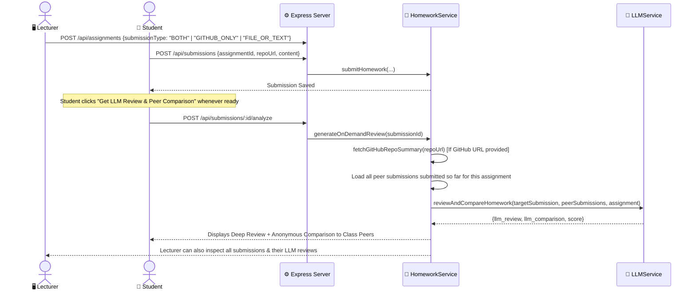

# Low-Level Class Diagrams & Sequence Diagrams — Task 8

**Project:** LiveClass AI — Web-Based Teaching Tool  

---

## 1. Low-Level UML Class Diagram

The following UML class diagram details the object-oriented classes, attributes, method signatures, and associations implemented in `src/db/` and `src/services/`.

```mermaid
classDiagram
    class DatabaseManager {
        -DatabaseSync db
        -string dbPath
        +constructor(dbPath: string)
        +initSchema() void
        +seedInitialData() void
        +getDb() DatabaseSync
        +close() void
    }

    class AuthService {
        -DatabaseManager dbManager
        -OAuth2Client googleClient
        -Set~string~ adminEmails
        +constructor(dbManager: DatabaseManager)
        +authenticateGoogleUser(payload: Object) User
        +switchUserRole(userId: number, newRole: string) User
        +getUserById(userId: number) User
        +getAllUsers() User[]
    }

    class AttendanceService {
        -DatabaseManager dbManager
        +constructor(dbManager: DatabaseManager)
        +createCourse(lecturerId: number, code: string, name: string, description: string) Course
        +getCoursesForUser(userId: number, role: string) Course[]
        +enrollStudent(courseId: number, studentId: number) Enrollment
        +startSession(courseId: number, title: string, lat: number, lng: number, maxDist: number) Session
        +endSession(sessionId: number) Session
        +calculateHaversineDistance(lat1: number, lon1: number, lat2: number, lon2: number) number
        +checkInStudent(params: CheckInRequest) AttendanceRecord
        +updatePhotoHeadcount(sessionId: number, count: number, photoDataUrl: string) PhotoAuditResult
        +toggleManualAttendance(sessionId: number, studentId: number, status: string) AttendanceRecord
        +getCourseAttendanceHistory(courseId: number, filterStudentId: number) AttendanceHistoryReport
        +exportAttendanceCSV(courseId: number, sessionId: number) string
    }

    class QAService {
        -DatabaseManager dbManager
        +constructor(dbManager: DatabaseManager)
        +askQuestion(courseId: number, sessionId: number, studentId: number, content: string, isAnonymous: boolean) Question
        +dismissLiveQuestion(questionId: number) Question
        +replyToQuestion(questionId: number, replyText: string) Question
        +getQuestionsByCourse(courseId: number) Question[]
    }

    class PollService {
        -DatabaseManager dbManager
        +constructor(dbManager: DatabaseManager)
        +createPoll(sessionId: number, question: string, options: string[]) Poll
        +closePoll(pollId: number) Poll
        +castVote(pollId: number, studentId: number, optionIndex: number) VoteConfirmation
        +getPollResultsForLecturer(pollId: number) PollResults
    }

    class LLMService {
        -string apiKey
        +constructor(apiKey: string)
        +generateLectureSummary(transcript: string, liveQuestions: Question[], title: string) string
        +countPeopleInClassroomPhoto(imageBase64: string, clientDetectedCount: number) number
        +reviewAndCompareHomework(targetSubmission: Submission, peerSubmissions: Submission[], assignment: Assignment) HomeworkLLMFeedback
    }

    class HomeworkService {
        -DatabaseManager dbManager
        -LLMService llmService
        +constructor(dbManager: DatabaseManager, llmService: LLMService)
        +createAssignment(courseId: number, title: string, description: string, submissionType: string, dueDate: string) Assignment
        +submitHomework(assignmentId: number, studentId: number, repoUrl: string, content: string, fileName: string) Submission
        +fetchGitHubRepoSummary(repoUrl: string) string
        +generateOnDemandReview(submissionId: number) Submission
        +getAssignmentSubmissions(assignmentId: number) Submission[]
    }

    AuthService --> DatabaseManager : uses
    AttendanceService --> DatabaseManager : uses
    QAService --> DatabaseManager : uses
    PollService --> DatabaseManager : uses
    HomeworkService --> DatabaseManager : uses
    HomeworkService --> LLMService : delegates AI analysis
```

---

## 2. Sequence Diagrams for Core Features

### 2.1 Dual-Factor Attendance + Lecturer Phone-to-PC Classroom Photo Audit

### 2.2 Live Anonymous/Named Q&A (Projector Audio Alert) & Post-Class Offline Reply

### 2.3 On-the-Spot Multiple-Choice (KISS) Poll (Projector-Only Results)

### 2.4 Live Lecture Recording / Upload -> LLM Draft Summary -> Lecturer Publish

### 2.5 Configurable Homework Submission & On-Demand LLM Peer Comparison

